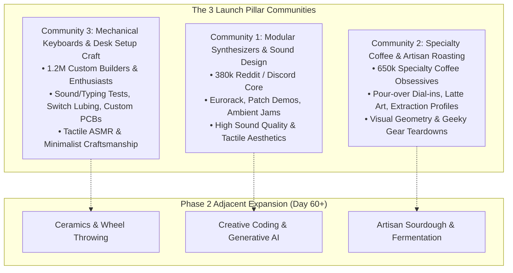
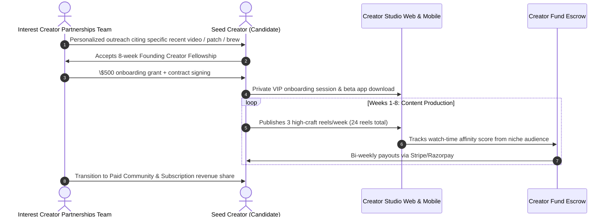
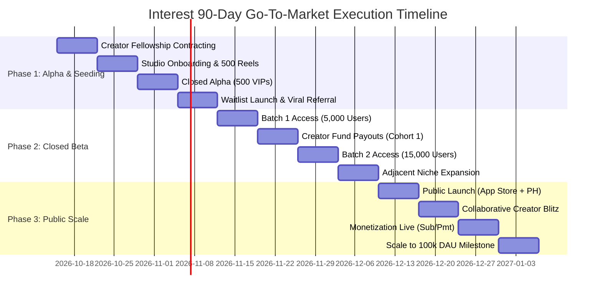

# Go-To-Market (GTM) Strategy & 90-Day Launch Playbook

**Interest Platform**  
*Pure Interest-Driven Social Media Platform | Zero-Location Architecture*

---

## 1. Executive Summary & Strategic Positioning

Mainstream short-video platforms (TikTok, Instagram Reels, YouTube Shorts) have succumbed to **algorithmic decay**:
- **Location-Biased Noise:** Forcing geographic proximity, city trends, and regional viral memes onto user feeds regardless of true personal passions.
- **Vanity Over Depth:** Optimizing for lowest-common-denominator rage bait, dance memes, and generic lifestyle flexing instead of deep craftsmanship and authentic obsessions.
- **Privacy Intrusion:** Relentlessly tracking GPS, WiFi SSIDs, and IP geolocation to monetize localized advertising.

**Interest** provides the antidote: **The pure interest-driven social video platform.**
- **Zero-Location Guarantee:** 100% geo-blind recommendation engine. No GPS, no city tags, no regional stereotypes.
- **Algorithmic Transparency:** Every reel displays a "Why am I seeing this?" modal breaking down interest vector affinity.
- **Craft-First Density:** Built for niche creators who care about mastery, tools, and technical depth.

To overcome the social media "cold start" problem, Interest executes a **Niche-First Launch Strategy**: dominating 3 obsessive, visually rich micro-communities before scaling to the broader market.

---

## 2. Niche-First Launch Strategy: The 3 Seed Communities

Rather than launching broadly to a generic audience with a dilute feed, Interest launches exclusively within **3 obsessive craft communities**. These communities have high visual/audio richness, active subcultures on Reddit/Discord/YouTube, and immense frustration with mainstream algorithm dilution.



### Community 1: Modular Synthesizers & Electronic Sound Design
- **Why this niche?** Eurorack synthesizers and hardware electronic instruments are intensely visual, tactile, and auditory. Creators spend hours patching cables, tweaking knobs, and designing sonic textures.
- **Pain Point on Mainstream Apps:** TikTok and Instagram algorithms constantly mute audio, compress dynamic range, or flag custom hardware performances for false copyright matches. Furthermore, algorithms push viral pop tracks rather than synth craft.
- **Interest Taxonomy Nodes:** `hardware-synths`, `eurorack-modular`, `ambient-soundscapes`, `circuit-bending`, `drum-machines`.
- **Target Audience Persona:** "Alex", 28, electrical engineer & music producer. Spends \$3,000+ on Eurorack modules. Wants to see modular patch routing, diode ladder filter sweeps, and generative polyrhythms without lifestyle influencer fluff.

### Community 2: Specialty Coffee & Artisan Roasting
- **Why this niche?** Coffee craft has exploded into high-precision culinary science: refractometer extraction yields, bean density, pour-over flow rate geometry, and latte art texture.
- **Pain Point on Mainstream Apps:** Mainstream feeds push sugary syrup Starbucks drinks and drive-thru reviews instead of single-origin Gesha dial-in techniques or espresso puck preparation.
- **Interest Taxonomy Nodes:** `specialty-coffee`, `espresso-profiling`, `pour-over-craft`, `latte-art`, `roasting-profiles`.
- **Target Audience Persona:** "Maya", 32, product designer & home barista. Weighs water to 0.1g, obsesses over grinder burr alignment, and loves slow-motion vertical pours and microfoam texturing.

### Community 3: Mechanical Keyboards & Desk Setup Craft
- **Why this niche?** High aesthetic visual appeal, ASMR sound profiles (thocky, clacky), custom CNC aluminum cases, artisan resin keycaps, and precision soldering.
- **Pain Point on Mainstream Apps:** Enthusiasts cannot find pure sound tests without background commentary, or their feeds get overwhelmed by generic dropshipping gaming gear.
- **Interest Taxonomy Nodes:** `custom-keyboards`, `switch-lubing`, `typing-asmr`, `artisan-keycaps`, `ergonomic-woodworking`.
- **Target Audience Persona:** "David", 24, software developer. Loves high-definition typing sound tests, tactile switch modifications, and bespoke wooden wrist rests.

---

## 3. Seed Creator Program: The "Founding 150"

To guarantee that Day-1 users enter feeds rich in high-affinity content, Interest will recruit and fund **150 Founding Creators** (50 per niche) prior to public opening.

### Creator Value Proposition
1. **100% Interest-Matched Audience:** Zero geographic or demographic dilution. A modular synth video reaches synthesizer obsessives in Tokyo, Berlin, and San Francisco equally.
2. **Guaranteed \$100,000 Seed Creator Fund:** Guaranteed minimum monthly stipends (\$500–\$1,500/month) based on verified interest watch time, not vanity follower counts.
3. **Founding Creator Status:** Permanent gold checkmark, founding profile badge, and reserved vanity username handles.
4. **Direct Product Hotline:** Dedicated private Discord server with the CEO, Chief Product Officer, and Recommendation Engine team.

### Creator Onboarding Playbook



- **Content Commitment:** 3 high-quality reels per week for 8 weeks (minimum 24 reels per creator $\to$ **3,600 pre-launch reels in database**).
- **Quality Guidelines:** Native 4K/60fps vertical capture, uncompressed clean audio, no cross-app watermarks (TikTok/Reels watermarks blocked), mandatory taxonomy tagging (1–5 niche tags).
- **Outreach Strategy:** Targeted direct outreach to YouTube long-form craft channels (5k–50k subs) who struggle with YouTube Shorts compression and TikTok virality algorithms.

---

## 4. Viral Waitlist & Referral Loop

Interest deploys a high-converting waitlist with a viral **K-Factor referral engine** designed to exceed $K = 1.25$.

```mermaid
flowchart LR
    Visitor["Visitor Lands on interest.app"] --> Input["Enters Email & Picks 3 Obsessions"]
    Input --> Queue["Assigned Waitlist Spot (e.g. #12,450)"]
    Queue --> Share["Personalized Referral Link Generated"]
    Share --> Invite["Invites Friends via WhatsApp / X / Telegram"]
    Invite --> Conversion["Friend Joins Queue"]
    Conversion --> Jump["Referrer Jumps 1,000 Spots Ahead"]
    Jump -->|3 Invites| VIP["Unlocks Instant VIP Alpha Access!"]
```



### Mathematical Virality Model
- **Target Viral Coefficient ($K$):**
  $$K = i \times c = 2.4 \times 0.55 = 1.32$$
  *Where $i = \text{invites sent per user}$ (2.4), and $c = \text{conversion rate per invite}$ (55%).*
- Since $K > 1.0$, the waitlist expands exponentially through organic peer-to-peer referral.

### Tiered Referral Incentives
| Referrals Made | Reward Unlocked | Psychology / Motivation |
| :---: | :--- | :--- |
| **0** | Standard Queue Position (e.g. #14,280). | Scarcity & FOMO. |
| **1** | Skip **1,000 spots** forward in line. | Instant gratification. |
| **3** | **Instant Access:** Immediate app invite code + "Founding Member" profile chip. | Low-barrier primary viral loop. |
| **5** | **VIP Creator Bundle:** Free 3-month pass to any Paid Interest Community + Early Handle Reservation. | High-value community driver. |

### Dynamic Share Cards
Every waitlist registrant receives an auto-generated dynamic OpenGraph share card tailored to their selected niche:
> *"I just joined the waitlist for Interest — the zero-location social app built for #ModularSynths. No algorithms pushing generic nonsense. Skip the line with my invite: interest.app/join?ref=synthgeek"*

---

## 5. App Store Listing & Screenshots Plan

### App Store (iOS) & Google Play Metadata

- **App Name:** `Interest: Pure Niche Feeds`
- **Subtitle (iOS):** `No Location. 100% Passion.`
- **Primary Category:** Social Networking
- **Secondary Category:** Entertainment / Hobbies
- **Keywords (ASO Target):** `synthesizer,specialty coffee,keyboards,craft,reels,shorts,zero tracking,privacy,niche,video,maker,diy`

### Marketing Copy (Full Description)
```text
Tired of algorithms pushing local gossip, viral dance trends, and generic rage bait?

Welcome to Interest — the pure interest-driven social video app.

We believe social media should feed your mind, not track your location. On Interest, there is ZERO location tracking, ZERO city-based trending, and ZERO regional stereotypes. Your feed is powered entirely by what you love.

WHY ENTHUSIASTS LOVE INTEREST:
• 100% PURE INTEREST FEEDS: Choose from hundreds of micro-communities — from modular synthesizers and espresso profiling to custom mechanical keyboards and pottery craft.
• ALGORITHMIC TRANSPARENCY: Every reel features a "Why am I seeing this?" button that reveals the exact interest vector match. No black-box secrets.
• ZERO-LOCATION PRIVACY: We do not collect, process, or sell your GPS, IP city, or geographic data. Ever.
• CREATOR-FIRST CRAFT: High-fidelity audio, precision editing tools, and a creator fund that rewards depth over vanity virality.
• AD-FREE COMMUNITY OPTION: Support your favorite creators directly through tips, creator subscriptions, and paid interest communities.

Stop scrolling through strangers. Start scrolling your obsessions.
Download Interest today.
```

---

### Screenshot Sequence Plan (6 Panoramic Frames)

| Frame # | Visual Headline | UI Mockup & Device Screen Element | Psychological Focus |
| :---: | :--- | :--- | :--- |
| **1** | *"Stop scrolling strangers. Start scrolling your obsessions."* | Full-screen vertical reel of Eurorack modular patch with oscilloscope overlay. Zero clutter. | Contrast against mainstream feed fatigue. |
| **2** | *"No GPS. No City. 100% What You Love."* | Onboarding screen showing zero-location badge and taxonomy chips: `#ModularSynths`, `#PourOverCoffee`, `#Keyboards`. | Uncompromising privacy & interest purity. |
| **3** | *"Every Reel Explains Itself."* | Algorithmic Transparency Sheet open: *"Matched on Interests: Modular Synths (94%). 0% Geographic Signals."* | Trust & radical transparency. |
| **4** | *"Tap Any Tag to Dive Deeper."* | User finger tapping floating `#ArtisanKeycaps` chip pill, transitioning feed to topic silo. | Exploration & flow state. |
| **5** | *"Built for Craft, Not Vanity Virality."* | Creator Studio interface showing waveform audio editor, color grading filters, and taxonomy selector. | Creator empowerment & tooling. |
| **6** | *"Privacy by Design. Zero Tracking."* | Privacy Shield badge with CCPA / GDPR / DPDP verified compliance toggles. | Safety & user data autonomy. |

---

## 6. High-Converting Landing Page Architecture

The public landing page (`apps/admin/app/landing/page.tsx` & `interest.app`) features:
1. **Hero Section:** Bold typographic hook, live waitlist signup form with email + interest picker, and real-time live waitlist counter badge.
2. **Interactive Interest Selector:** Allows visitors to click chips (`Modular Synths`, `Pour-Over Coffee`, `Custom Keyboards`, `Pottery`, `Creative Coding`) to see preview reel snippets.
3. **Contrast Comparison Matrix:** "Mainstream Feeds (TikTok/Reels)" vs. "Interest".
4. **Creator Showcase Carousel:** Showcasing our Founding 150 creators and their gear setups.
5. **Zero-Location Privacy Pledge:** Clear legal and technical guarantee of zero geolocation tracking.
6. **Viral Referral Modal:** Instant popup after submission with unique invite link, social share buttons, and queue position indicator.

---

## 7. 90-Day Growth Roadmap with Weekly Goals



### Phase 1: Seed Seeding & Private Alpha (Weeks 1–4)

#### Week 1: Seed Creator Recruitment & Contracting
- **Goal:** Sign 150 Founding Creators (50 in Synths, 50 in Coffee, 50 in Keyboards).
- **Deliverables:** Execute Creator Fellowship contracts (\$500 onboarding stipend + fund access). Distribute private TestFlight/APK builds.
- **KPI:** 150 signed creator agreements; 100% onboarded to Private Discord salon.

#### Week 2: Content Seeding Sprint
- **Goal:** First 1,000 high-craft reels published to staging/alpha database.
- **Deliverables:** Conduct 1-on-1 white-glove editing sessions with top 30 creators. Verify high-fidelity audio transcoding and zero-location tagging.
- **KPI:** 1,000+ completed reels ready in feed repository; average video bitrate 1.5 Mbps.

#### Week 3: Closed Alpha (500 VIP Community Members)
- **Goal:** Invite 500 hardcore community moderators and enthusiasts from r/modular, r/espresso, r/MechanicalKeyboards.
- **Deliverables:** Measure initial feed engagement, watch time, and vector affinity accuracy. Tune cold-start embedding recommendations.
- **KPI:** Average session duration $> 18\text{ minutes}$; Day-1 retention $\ge 60\%$.

#### Week 4: Waitlist Launch & Viral Engine Activation
- **Goal:** Launch `interest.app` landing page and public waitlist with referral loop.
- **Deliverables:** Release dynamic OpenGraph share cards; launch teaser video on X/Twitter and Reddit; activate Product Hunt upcoming page.
- **KPI:** 25,000 waitlist registrations in first 7 days; Referral $K\text{-factor} \ge 1.20$.

---

### Phase 2: Closed Beta & Community Density (Weeks 5–8)

#### Week 5: Batch 1 Waitlist Gate (5,000 Users Released)
- **Goal:** Onboard top 5,000 referrers into iOS TestFlight and Android Open Beta.
- **Deliverables:** Monitor server load under k6 feed profiles (sub-120ms p95 latency); evaluate comment density on seed creator reels.
- **KPI:** 5,000 active beta testers; 15,000 daily reel views; zero location violation alerts.

#### Week 6: Creator Fund Distribution & Creator Salon
- **Goal:** Execute first bi-weekly Creator Fund payout (\$25,000 distributed based on watch time).
- **Deliverables:** Host first live Creator Town Hall; release in-app creator analytics dashboard (views by interest audience, retention curve).
- **KPI:** 100% on-time creator payouts; creator retention $> 95\%$.

#### Week 7: Batch 2 Waitlist Gate (15,000 Users Released)
- **Goal:** Release next 15,000 users from waitlist.
- **Deliverables:** Deploy A/B test on onboarding screen (comparing 3 vs 5 mandatory interest chip picks); test WebSocket DM performance under load.
- **KPI:** 20,000 total active users; D7 retention $\ge 42\%$; K-factor sustained at $1.25$.

#### Week 8: Expansion into 3 Adjacent Niches
- **Goal:** Seed 3 adjacent craft communities to broaden taxonomy reach:
  1. *Ceramics & Wheel Throwing* (pairs with coffee aesthetics).
  2. *Creative Coding & Generative AI* (pairs with synth hackers).
  3. *Artisan Sourdough & Fermentation* (pairs with culinary precision).
- **Deliverables:** Sign 75 new creators (25 per new niche); seed 500 new reels.
- **KPI:** Total active catalog reaches 5,000+ reels across 6 thriving communities.

---

### Phase 3: Public Launch & Scaling Flywheel (Weeks 9–12)

#### Week 9: Public App Store Release & Product Hunt Launch
- **Goal:** Remove waitlist barrier; public launch on Apple App Store & Google Play.
- **Deliverables:** Launch Product Hunt campaign (aiming for **#1 Product of the Day / #1 Product of the Week**); execute tech press embargo with TechCrunch, The Verge, and Wired focusing on the "Zero-Location Social App" angle.
- **KPI:** 30,000 new downloads in 48 hours; #1 on Product Hunt; App Store rating $\ge 4.8\text{ stars}$.

#### Week 10: Collaborative Niche Blitz Campaign
- **Goal:** Launch "The Obsession Tournament" — cross-niche collaborative video challenge.
- **Deliverables:** Creators post joint patch sessions, coffee brewing tests, and desk sound builds. Viral TikTok/IG crossover clips directing to full-fidelity Interest feeds.
- **KPI:** 50,000 DAU achieved; $> 1.8\text{ million daily reel views}$.

#### Week 11: Monetization Go-Live
- **Goal:** Open Creator Subscriptions, Tips, and Paid Communities.
- **Deliverables:** Creators launch exclusive monthly masterclasses (e.g. "\$5/mo Eurorack Patch Notes Community"); Stripe & Razorpay instant payout rail active.
- **KPI:** \$50,000 in Gross Merchandise Value (GMV) transacted in first 14 days; 8% user-to-paying conversion in core communities.

#### Week 12: 90-Day Milestone Review & Series A Readiness
- **Goal:** Achieve sustained growth flywheel and institutional metric benchmarks.
- **Deliverables:** Compile comprehensive 90-day retention and unit economics report; initiate Series A fundraising conversations.
- **Targets Achieved:**
  - **100,000 Daily Active Users (DAU)** (350k MAU).
  - **4,000,000 Daily Reel Views**.
  - **D30 Retention $\ge 35\%$** (exceeding industry benchmark of 24%).
  - **Blended Organic Acquisition Cost:** **\$0.22 per install**.
  - **Zero-Location Compliance:** 100% verified across 100M+ feed interactions.
