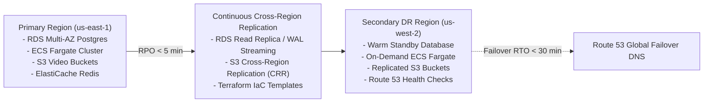
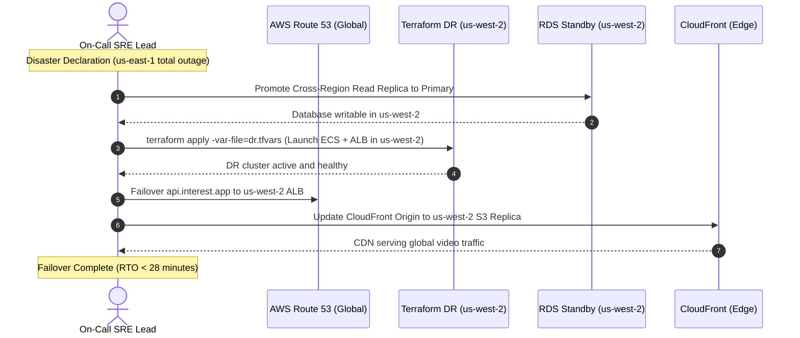

# Disaster Recovery (DR) Plan & Business Continuity Runbook

**Interest Platform**  
*Pure Interest-Driven Social Media Platform | Zero-Location Architecture*

---

## 1. Disaster Recovery Objectives & Classification

The **Interest** platform operates under strict Recovery Point Objectives (**RPO**) and Recovery Time Objectives (**RTO**) to guarantee high availability and prevent data loss during catastrophic regional infrastructure events.



| Metric | Target Objective | Implementation Mechanism |
| :--- | :--- | :--- |
| **RPO (Recovery Point Objective)** | **< 5 minutes** | RDS continuous WAL streaming, 5-minute automated transaction log backups, S3 Cross-Region Replication (CRR). |
| **RTO (Recovery Time Objective)** | **< 30 minutes** | Infrastructure as Code (Terraform) automated cold/warm spin-up in `us-west-2`, Route 53 DNS failover routing. |
| **Data Integrity Invariant** | **100% Zero-Loss** | ACID PostgreSQL transactions, S3 Versioning, immutable `.ts` video chunk storage. |
| **Zero-Location Invariant** | **Fail-Closed** | Edge CloudFront sanitization active in both primary and secondary failover distributions. |

---

## 2. Backup Architecture & Policies

### 1. PostgreSQL 16 (with pgvector)
- **Continuous WAL Archiving:** Database write-ahead logs are continuously streamed to an encrypted S3 bucket (`interest-backups-production`), enabling **Point-in-Time Recovery (PITR)** down to the second.
- **Automated Daily Snapshots:** Captured at 03:00 UTC with **35-day retention**.
- **Cross-Region Snapshot Copying:** Daily RDS snapshots are automatically copied to `us-west-2` via AWS Backup.
- **Enhanced Monitoring & Crash Consistency:** Transaction logs use `synchronous_commit = on` for financial ledgers and reel creation.

### 2. S3 Media & Video Storage
- **S3 Versioning:** Enabled on `interest-raw-uploads-production` and `interest-backups-production`.
- **Cross-Region Replication (CRR):** S3 bucket replication rule automatically replicates all transcoded HLS chunks (`.m3u8`, `.ts`) from `us-east-1` to `us-west-2`.
- **S3 Object Lock (WORM):** Legal compliance exports and audit logs are locked against deletion for 365 days.

### 3. ElastiCache Redis (BullMQ Queues & Caching)
- **Daily Automated Snapshots:** Captured at 02:00 UTC with 7-day retention.
- **Cache Reconstructibility:** Redis is treated as an ephemeral state layer. If Redis is completely lost:
  1. BullMQ pending transcode jobs are automatically reconstructed from the PostgreSQL `reels WHERE status = 'QUEUED'` table.
  2. Redis Bloom filter for viewed reels is rebuilt within 4 minutes from the `telemetry_reel_views` log.

---

## 3. Disaster Scenarios & Failover Runbooks

### Scenario A: Database Logical Corruption / Accidental Deletion
*Trigger: Accidental table drop, corrupted batch migration, or rogue script.*

1. **Identify Timestamp of Incident:**
   - Review PostgreSQL audit logs or CloudWatch query insights to identify the exact timestamp $T_{\text{error}}$.
2. **Execute Point-in-Time Recovery (PITR):**
   ```bash
   aws rds restore-db-instance-to-point-in-time \
     --source-db-instance-identifier interest-postgres-production \
     --target-db-instance-identifier interest-postgres-production-restored \
     --restore-time "2026-10-12T14:59:58Z" \
     --db-subnet-group-name interest-rds-subnets-production \
     --vpc-security-group-ids sg-rds-production
   ```
3. **Verify Integrity & Swap Endpoints:**
   - Connect to `interest-postgres-production-restored` and verify vector tables and taxonomy integrity.
   - Update Route 53 private hosted zone CNAME `db.interest.internal` to point to the restored DB instance.
   - Restart ECS tasks to refresh database connection pools.

---

### Scenario B: Single Availability Zone Outage (e.g. `us-east-1a` fails)
*Trigger: Network partition or hardware failure in a single AWS AZ.*

- **Database:** AWS RDS Multi-AZ automatically detects the primary failure and promotes the standby replica in `us-east-1b` within **60 seconds**. DNS endpoint remains identical.
- **Redis:** ElastiCache Multi-AZ promotes replica node within **30 seconds**.
- **ECS Compute:** ECS service scheduler automatically launches replacement Fargate tasks in the healthy AZs (`us-east-1b`, `us-east-1c`).
- **Load Balancer:** ALB health checks immediately drain traffic from degraded targets in `us-east-1a`.
- **Expected Downtime:** **0 seconds** (Brief ~30s connection retry blip handled by NestJS TypeORM/pg connection retry policy).

---

### Scenario C: Complete Regional Outage (`us-east-1` Down)
*Trigger: Major fiber cut or power event impacting the entire US-East region.*



#### Step-by-Step Regional Failover Procedure:
1. **Declare Disaster:**
   - Incident Commander initiates P0 Emergency Bridge in Slack (`#incident-p0-disaster`).
2. **Promote DR PostgreSQL Database:**
   ```bash
   aws rds promote-read-replica \
     --db-instance-identifier interest-postgres-dr-uswest2 \
     --region us-west-2
   ```
3. **Provision DR Compute Infrastructure:**
   ```bash
   cd infra/terraform/environments/production
   terraform workspace select dr-uswest2
   terraform apply -var="aws_region=us-west-2" -auto-approve
   ```
4. **Update CloudFront Video Origin:**
   - Update CloudFront origin `S3-HLS-Bucket` to point to `interest-hls-video-dr-uswest2.s3-regional.amazonaws.com`.
5. **Route 53 Global DNS Cutover:**
   - Update Route 53 alias record `api.interest.app` to the new ALB DNS in `us-west-2`.
6. **Verify Zero-Location Invariant:**
   - Run verification probe against `https://api.interest.app/api/v1/health` and verify zero geo headers are forwarded.

---

## 4. Quarterly GameDay Simulation & Verification Drills

To ensure operational readiness, the engineering team executes automated disaster drills every 90 days:

1. **Drill 1: RDS Kill Drill:** Simulates sudden RDS primary crash to benchmark automated failover time (Pass criteria: `< 90s` failover, zero data loss).
2. **Drill 2: S3 Glacier Restoration Drill:** Restores 100 historical archived reels from Glacier to verify lifecycle integrity.
3. **Drill 3: Redis Cold Start Drill:** Flushes Redis completely during synthetic load test (10k VUs) to verify Bloom filter and BullMQ auto-reconstruction.
4. **Drill 4: Full DNS Regional Failover:** Switches 10% of synthetic traffic to `us-west-2` DR cluster and measures p95 latency.
